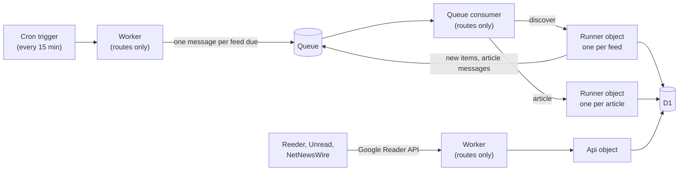

# rss8

**A self-hosted RSS aggregator that runs entirely on Cloudflare's free plan.** `rss8` fetches your feeds, stores clean full articles in D1, and serves the Google Reader API, so the reader apps you already use keep your read and starred state in sync across devices. There is no server to look after and nothing to pay.

Tested with **Reeder Classic 5.6** (iPad and iPhone), **Unread** (macOS) and **NetNewsWire** (macOS).

## 1. Why rss8

- **Free, for good.** Everything runs inside Cloudflare's free plan: Workers, Durable Objects, D1, Queues and a single cron trigger. There's no VPS, no database server and no PHP.
- **Your apps, your choice.** `rss8` has no reading interface of its own. It speaks the Google Reader API (the same flavour FreshRSS serves), so you read in a native app.
- **Sync that just works.** Read an article on the iPad and it shows as read on the Mac at the next refresh. Stars sync the same way.
- **Full articles, not snippets.** Feed entries are stored complete. A source can also fetch and clean the article page itself, for feeds that send only a teaser.
- **Your feeds, in code.** Feeds, folders, schedules and retention live in one TypeScript config file under version control. Changing them is a deploy.
- **Extensible.** A new kind of source is a small TypeScript module. Adding one never needs schema or engine changes.

## 2. Background

Several cloud providers give you a small VM that's free forever, and most give you one for a year. Cloudflare's free plan is just as permanent, but it isn't a VM or a container. It's Workers, Durable Objects and D1, which don't run a classic self-hosted app like FreshRSS (PHP) or a Python scraper. So the free allowance on most Cloudflare accounts goes unused. `rss8` started as an experiment, built with Claude, to see whether a personal RSS aggregator fits inside that allowance. It does, with room to spare.

## 3. Is it for you?

`rss8` is deliberately small. It may not suit you if you want:

- **Multi-user.** There's one account (and one password) only. `rss8` is a *personal* RSS aggregator.
- **A web reading interface.** Reading happens in your app. The Worker serves only the API, `/health` and `/admin`.
- **The Fever API.** Only the Google Reader API is implemented, not Fever API.
- **To manage feeds from your app.** You add, remove and file feeds in the config and deploy. Folder edits from the app are refused, and labels on single articles aren't supported.
- **Instant push.** Changes reach your other devices when they next refresh.

You'll need a Cloudflare account, Node.js, and to be comfortable with `wrangler` and a little TypeScript.

## 4. How it works



- **Plain Workers only route.** On the free plan a Worker invocation gets 10 ms of CPU, too little to parse a feed or answer a full sync. So the cron, the queue consumer and the fetch handler each forward their work to a Durable Object, which gets about 30 s.
- **One unit of work per invocation.** Each feed's discover runs in its own Runner object, and so does each article. Failures retry through the queue, with backoff.
- **D1 is the only store.** Objects keep nothing between requests, and every sync query hits an index.
- **The engine schedules feeds itself.** A single cron trigger ticks every 15 minutes, and the engine decides which feeds are due from each feed's own cron-style `schedule`.
- **Retention runs daily.** It removes old read and unread items. Starred items are never removed.

### 4.1. The always-free-plan budget

| Allowance (per day) | Limit | What rss8 uses |
|---|---|---|
| D1 rows read | 5 M | About 2.8 M at 9,000 retained items with three devices syncing every 15 minutes. This is the allowance closest to its limit; retention keeps it in check |
| D1 rows written | 100 k | New items, read and star changes, and retention |
| Queue operations | 10 k | About 3 per message: one message per feed run and one per article fetched |
| Worker requests | 100 k | Cron ticks, queue deliveries and API calls from your apps |
| Durable Object requests | 100 k | One per feed run, per article and per API call |
| D1 storage | 500 MB | Set by retention. The daily report shows the size |

## 5. Deploy and run

### 5.1. Prerequisites

- A Cloudflare account. The free plan is enough.
- Node.js 24 or later, and git.

### 5.2. Deploy

Your deployment lives in a repo of your own, which can stay private, with `rss8` as a git submodule. Your config, any sources of your own and your CI live there. Updating `rss8` means moving the submodule.

```bash
mkdir my-rss8 && cd my-rss8 && git init
git submodule add -b main https://github.com/ivan98/rss8 vendor/rss8
git -C vendor/rss8 checkout v0.1.0    # optional: pin to a release instead of following main
cp -R vendor/rss8/examples/basic/src vendor/rss8/examples/basic/rss8.config.ts vendor/rss8/examples/basic/wrangler.jsonc .
```

Add a `package.json` that makes the submodule's packages workspaces:

```json
{
  "private": true,
  "type": "module",
  "workspaces": ["vendor/rss8/packages/*"],
  "dependencies": {
    "@rss8/engine": "*",
    "@rss8/source-rss": "*",
    "@rss8/source-substack": "*"
  },
  "devDependencies": { "wrangler": "4.152.0" }
}
```

In `wrangler.jsonc`, set `migrations_dir` to `vendor/rss8/packages/engine/migrations` and `$schema` to `node_modules/wrangler/config-schema.json`. Then create the resources, set the secrets and deploy:

```bash
npm install
npx wrangler login
npx wrangler d1 create rss8          # put the printed database_id into wrangler.jsonc
npx wrangler queues create rss8
npx wrangler d1 migrations apply rss8 --remote
npx wrangler secret put API_PASSWORD # the password your apps sign in with, at least 8 characters
npx wrangler secret put AUTH_SECRET  # signs login tokens, at least 32 characters
npx wrangler secret put ADMIN_TOKEN  # bearer token for /admin, at least 32 characters
npx wrangler deploy
curl https://<your-worker>.workers.dev/health
```

Use `openssl rand -hex 32` for `AUTH_SECRET` and `ADMIN_TOKEN`. Without `API_PASSWORD` and `AUTH_SECRET` every login is refused, and without `ADMIN_TOKEN` the admin routes answer 503.

To update later, move the submodule, then apply migrations and deploy, in that order: migrations always go first.

- **To a [release](https://github.com/ivan98/rss8/releases)** (read its "Upgrading" notes first): `git -C vendor/rss8 fetch --tags && git -C vendor/rss8 checkout v0.2.0`, using the new version.
- **Or to the latest `main`:** `git submodule update --remote vendor/rss8`.

Then run `npm install`, `npx wrangler d1 migrations apply rss8 --remote` and `npx wrangler deploy`, and commit `vendor/rss8`.

The entry point registers your sources and re-exports the two Durable Object classes under fixed names:

```ts
import { createWorker } from "@rss8/engine";
import rss from "@rss8/source-rss";
import substack from "@rss8/source-substack";
import config from "../rss8.config";

export { Runner, Api } from "@rss8/engine";
export default createWorker({ sources: [rss, substack], config });
```

`wrangler.jsonc` must bind the following, all of which `examples/basic` already does:

- `DB`, the D1 database, with `migrations_dir` pointing at the engine's migrations.
- `RUNNER` and `API`, the Durable Objects, declared as SQLite classes in the `exports` block.
- `QUEUE`, the queue, as producer and consumer, with `max_batch_size: 1` and `max_retries: 3`.
- Exactly one cron trigger, for example `"0,15,30,45 * * * *"`. It may restrict only the minute field: Cloudflare runs cron triggers in UTC and the engine evaluates schedules in your time zone, so the ticks must land on the same minutes either way.

### 5.3. Add feeds

Feeds live in `rss8.config.ts`, which is the source of truth: the engine syncs the database to it on every tick.

```ts
import { defineConfig } from "@rss8/engine";

export default defineConfig({
  timezone: "Europe/London",
  retention: { readDays: 30, unreadDays: 90, maxItems: 1000 },
  tombstoneDays: 365,
  feeds: [
    { key: "system", source: "system", enabled: true, title: "rss8" },
    {
      key: "example-blog",
      source: "rss",
      enabled: true,
      title: "Example Blog",
      category: "Tech",
      siteUrl: "https://blog.example.com/",
      options: { url: "https://blog.example.com/feed.xml" },
      schedule: ["10 * * * *"],
    },
  ],
});
```

- **Built-in sources:**
  - `rss`: any RSS or Atom feed whose entries carry the whole article.
  - `substack`: a Substack publication, with Substack's page markup reduced to plain HTML.
  - `system`: `rss8`'s own messages (below).
- **`category`** puts a feed in a folder, at most one per feed. Feeds and folders appear in config order.
- **`schedule`** takes 5-field cron expressions, evaluated in `timezone`. A feed runs on the first tick at or after a match. Without one, the source's default applies (hourly for `rss` and `substack`).
- **`retention`** sets defaults that a feed can override for itself. Ages count from when rss8 first fetched the item.
- **To pause a feed**, set `enabled: false` and deploy. Its items stay.
- **The `system` feed is required.** `rss8` posts to it when a feed starts failing or recovers, and once a day after maintenance with a health report covering every feed, the library totals and the database size. A missing daily report means the cron itself has stopped.

### 5.4. Connect your reader

Sign in with **any user name** and your `API_PASSWORD`.

| App | Account type | Server URL |
|---|---|---|
| Reeder Classic 5.6 | FreshRSS | `https://<your-worker>.workers.dev/api/greader.php` |
| Reeder Classic 5.6 | Reader (Google Reader API) | `https://<your-worker>.workers.dev` |
| Unread | FreshRSS | `https://<your-worker>.workers.dev/api/greader.php` |
| NetNewsWire | FreshRSS | `https://<your-worker>.workers.dev/api/greader.php` |

Other Google Reader API clients should work too: the engine also serves `unread-count`, `stream/contents` and `mark-all-as-read`, which these three apps don't use. They are untested, though, so please report what you find.

### 5.5. Keep it running

`rss8` tells you about itself through the `system` feed, so problems show up in your reader. `/health` reports the running version. Behind `ADMIN_TOKEN`, the admin routes run a feed or an article on demand and retry failed articles. A sensible CI pipeline applies migrations before each deploy, tags every deploy, and smoke-tests `/health` and the login afterwards. Pull requests can get their own `wrangler preview`, with a separate database. Two rules matter for rollbacks: migrations only ever add, and a Durable Object class change ships alone, because `wrangler rollback` can't cross it.

See [docs/operations.md](docs/operations.md) for the admin routes, CI and previews, rollback and the limits worth watching.

## 6. Writing a source

A source tells `rss8` how to find the items of a feed (`discover`) and, if the feed carries only teasers, how to fetch and clean each article (`fetchArticle`). It's a plain object with a `kind` that your config names. Its bookkeeping lives in a per-feed JSON state that the engine stores, so a source never touches the schema. [`@rss8/source-kit`](packages/source-kit) adds fixture-based golden tests and an `inspect` tool that runs your pipeline in real workerd against a live or saved page. See [docs/writing-a-source.md](docs/writing-a-source.md) for the interface, the CPU rules for HTML work, and the test and inspect tools.

## 7. Contributing

| Package | What it is |
|---|---|
| [`@rss8/engine`](packages/engine) | Schema and migrations, cron and queue, the `Runner` and `Api` Durable Objects, feed parsing, the Google Reader API, admin routes |
| [`@rss8/source-rss`](packages/source-rss) | The `rss` source |
| [`@rss8/source-substack`](packages/source-substack) | The `substack` source |
| [`@rss8/source-kit`](packages/source-kit) | Test harness, `inspect` and `measure` tools for source authors |
| [`examples/basic`](examples/basic) | A deployment to copy |

Run `npm run check` (typecheck, lint, and the tests in workerd) before you open a pull request. The sync rules (complete id sets, the three item-id formats, `mark-all-as-read` bounds) are covered by contract tests replayed from real client sessions. Keep them green.

## 8. License

[MIT](LICENSE)
